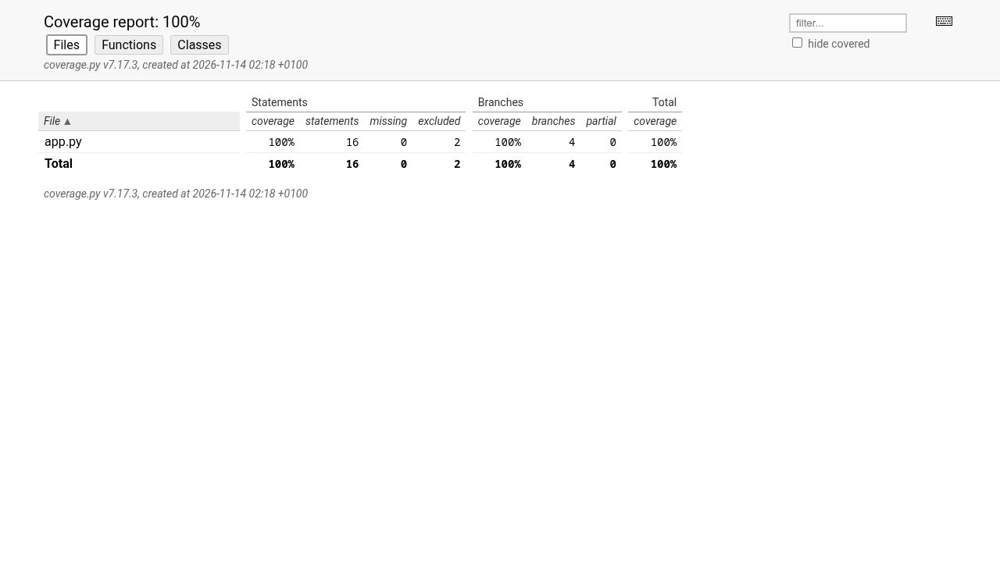
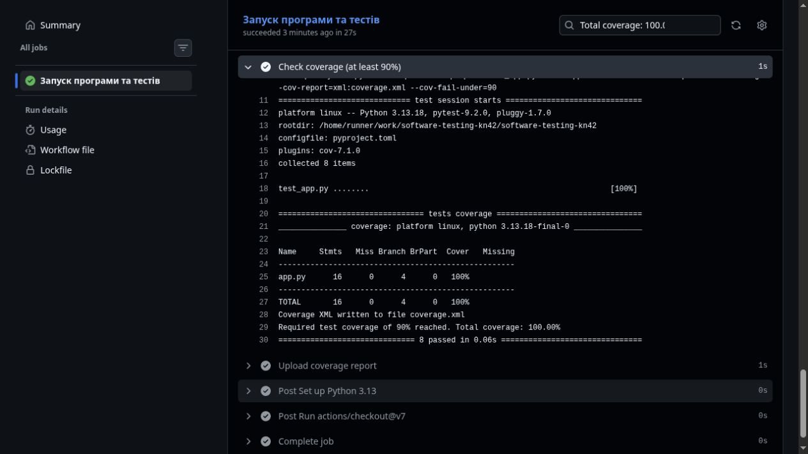

# Звіт до роботи 3

**Виконав Костюк Артем, група КН-42**

## Тема

Покриття коду

### Мета роботи

Виміряти покриття рядків і розгалужень окремими запусками unittest та pytest, перевірити мінімальний поріг.

---

### Виконання роботи

1. Початковий дослід запускав тільки трикутник. У звіті не виконано рядки 13, 16, 20 і 24. Покриття становило **71%**. Виклик `get_angles` без твердження виконав код. Додавання `assert ... == 3` залишило ті самі 71%, але перевірило правильність результату. [До assert](results/03-no-assert-report.txt) · [Після assert](results/03-with-assert-report.txt).
2. `# pragma: no cover` застосовано лише до умови запуску скрипта. При однаковому тесті покриття стало **75%**. Вивід функції `main()` перевірено окремо, тому поведінка програми залишається під тестом. [Дослід виключення](results/03-pragma-report.txt).
3. Додано перевірки квадрата, прямокутника, трикутника, запасного результату, неправильних аргументів та виводу `main()`. [Конфігурація](../../example/testing/03_coverage/.coveragerc) обмежує вимірювання модулем `app`. У таблиці немає тестових файлів.
4. У [групових матеріалах](src/lab3) перевірено від’ємну гілку, об’єднання рядків і виклик обробника. Виключення тіла `main()` замінено виключенням лише умови запуску. У [груповому звіті](results/03-group-report.txt) виконано 35 операторів і 6 гілок.
5. Поріг **90%** не пройшов у [початковому досліді](results/03-baseline-threshold.txt) і пройшов після додавання тестів. [Груповий запуск pytest-cov](results/03-group-pytest.txt). Перевірку цього порога включено до workflow роботи №5.

| Набір | Тестів | Рядків виконано | Гілок виконано | Покриття |
| --- | ---: | ---: | ---: | ---: |
| [Figure, unittest](results/03-teacher-unittest-report.txt) | 7 | 16 з 16 | 4 з 4 | 100% |
| [Figure, pytest](results/03-teacher-pytest-report.txt) | 8 | 16 з 16 | 4 з 4 | 100% |
| [Груповий приклад, unittest](results/03-group-report.txt) | 11 | 35 з 35 | 6 з 6 | 100% |

```bash
cd example/testing/03_coverage
poetry run coverage erase
poetry run coverage run -m unittest discover -v
poetry run coverage report -m
poetry run coverage erase
poetry run coverage run -m pytest --import-mode=prepend -p no:pytest_cov test_app.py -v
poetry run coverage report -m
poetry run pytest --import-mode=prepend test_app.py --cov=app --cov-branch --cov-fail-under=90
poetry run coverage html
poetry run coverage xml
```

HTML показує виконані й пропущені рядки. У браузері перевірено зведення та деталізацію для `app.py`. [XML-звіт](results/coverage.xml) містить дані про покриття рядків і гілок. Локальну папку `htmlcov/` виключено через `.gitignore`.



У [GitHub Actions](https://github.com/Funyk/software-testing-kn42/actions/runs/43541828276) та сама перевірка пройшла 8 тестів і показала 100% покриття `app.py`, як і локальний запуск. Поріг 90% пройдено. GitHub зберіг [coverage-report](https://github.com/Funyk/software-testing-kn42/actions/runs/43541828276/artifacts/14091279734) з файлом `coverage.xml`.



---

### Висновок

Мету досягнуто. Покриття рядків відповідає на питання, які оператори виконано, а покриття гілок показує, які переходи пройдено. Навіть 100% покриття не гарантує відсутності помилок, бо тести можуть не перевірити потрібні дані або очікувані результати. Окремі запуски полегшують порівняння наборів тестів.

### Джерела

[Методичка](https://github.com/BobasB/it_college/tree/f04f70102c2fe3cef4a27e32135a6689c14bf5d3/notes/07_testing/03_coverage) · [Матеріали занять](https://github.com/BobasB/2025_kn33_oop/tree/fd26a93cfd01e34ad774061100d2fbfaeb1b48fa/testing/3_lab)
