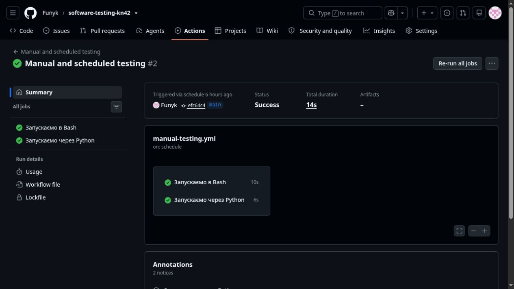
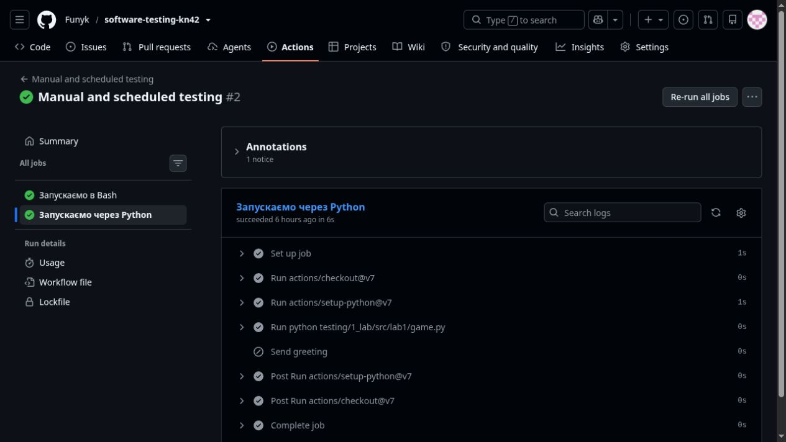
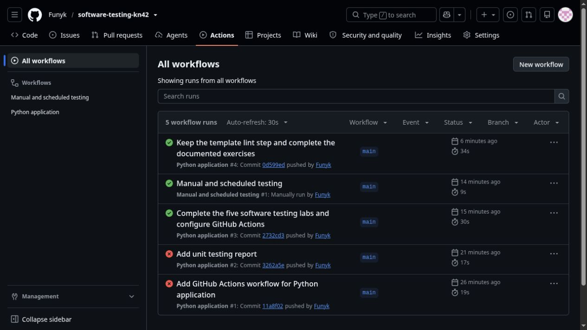

# Звіт до роботи 5

**Виконав Костюк Артем, група КН-42**

## Тема

Автоматизація запуску тестів через GitHub Actions

### Мета роботи

Створити workflow з шаблону та вручну, запустити програму і тести, перевірити ручний запуск з параметром, запуск за розкладом та умовне виконання кроку.

---

### Виконання роботи

1. У вкладці **Actions** вибрано **Python application → Configure**. Шаблон збережено без редагування у [першому коміті](https://github.com/Funyk/software-testing-kn42/commit/11a8f022d53050125e78651250f81ecd6bb9ccf5). Він отримує код через `checkout`, готує Python через `setup-python`, встановлює пакети, виконує статичну перевірку `flake8` і запускає `pytest`.
2. У [python-app.yml](../../.github/workflows/python-app.yml) налаштовано Python 3.13 і встановлення залежностей через Poetry. З шаблону збережено перевірку `flake8`, у якій синтаксичні помилки та невизначені імена зупиняють збірку, а зауваження до стилю залишаються у журналі. Крок `Run Python` запускає `game.py` з роботи №1. Далі `pytest -v` запускає весь набір тестів. Окремий крок роботи №3 перевіряє поріг 90% для `app.py` і зберігає `coverage.xml` як артефакт `coverage-report`.
3. У [manual-testing.yml](../../.github/workflows/manual-testing.yml) налаштовано `workflow_dispatch` з текстовим параметром `name` та `schedule` із часом `53 2 * * 6`. Це субота о 02:53 UTC. Два завдання запускають груповий сценарій Bash і програму Python з роботи №1. Крок `Send greeting` виконується лише за ручного запуску, якщо передано ім’я, відмінне від `Executer`. Після одноразової перевірки розклад закоментовано відповідно до методички; `workflow_dispatch` залишається активним.

[Перший запуск шаблону](https://github.com/Funyk/software-testing-kn42/actions/runs/43540733689) завершився кодом `5`, тому що в репозиторії ще не було тестів. Журнал `pytest` показав `collected 0 items`. [Початковий стан у вкладці Actions](pictures/template.png).

У матеріалах групи є демонстрація помилки запуску. [`action.sh`](action.sh) завершився з кодом `0`, а [`action.py`](action.py) вивів повідомлення про помилку та через `SystemExit` завершився з кодом `1`. [Вивід Bash](results/05-group-bash.txt) · [Вивід Python](results/05-group-python.txt).

### Результати

| Запуск | Результат |
| --- | --- |
| [Python application](https://github.com/Funyk/software-testing-kn42/actions/runs/43542647725) | Перевірка `flake8` пройшла без критичних помилок. Пройдено 118 тестів і 12 підтестів. Один навчальний тест позначено `skip`. Окрема перевірка `app.py` показала 100% при порозі 90%. |
| [Ручний запуск з `name=Артем`](https://github.com/Funyk/software-testing-kn42/actions/runs/43541871473) | Завдання Bash і Python пройшли. Крок `Send greeting` вивів `Привіт, Артем!`. |
| [Запуск за розкладом (`schedule`)](https://github.com/Funyk/software-testing-kn42/actions/runs/43580808544) | 14.11.2026 о 09:29:48 UTC створено фактичний автоматичний запуск. Bash і Python завершилися успішно; `Send greeting` отримав стан `skipped`, як передбачено умовою. |

Вираз `53 2 * * 6` перевірено в [CronTab Guru](https://crontab.guru/#53_2_*_*_6). Для GitHub Actions час у виразі задано в UTC. [Перевірка виразу](pictures/cron-expression.png).

14 листопада 2026 року о 03:01 UTC запису `schedule` ще не було, тому на той момент перевірка залишалася незавершеною. Пізніше GitHub створив [запуск №43580808544](https://github.com/Funyk/software-testing-kn42/actions/runs/43580808544) саме з подією `schedule` на коміті `efc64c4a0178b057861618225dc81ae8961d0c19`. Запланований час — 02:53 UTC; фактичне створення — 09:29:48 UTC (10:29:48 за місцевим часом UTC+1), тобто на 6 год 36 хв 48 с пізніше. Запуск завершився успішно. Це підтверджує затримку фактичного запуску; точна внутрішня причина затримки GitHub із доступних журналів невідома.

Методичка вимагає виконати workflow за розкладом лише один раз, щоб не витрачати безкоштовні хвилини. Після успішної демонстрації `schedule` та вираз Cron залишено в [файлі workflow](../../.github/workflows/manual-testing.yml) як коментарі з посиланням на результат. Повторні автоматичні запуски припинено, ручний запуск з параметром залишається доступним.

[Підсумок CI та артефакт покриття](pictures/ci-success.png) · [Журнал повного набору тестів](pictures/ci-tests.png)

---

### Висновок

Workflow з шаблону автоматизує перевірки проєкту й контролює поріг покриття. Другий workflow демонструє незалежні завдання, ручний параметр, фактичний запуск за розкладом та обидва результати умови: привітання виконано вручну й пропущено автоматично. Усі ці результати підтверджено журналами GitHub Actions і скриншотами.

### Джерела

[Методичка](https://github.com/BobasB/it_college/tree/f04f70102c2fe3cef4a27e32135a6689c14bf5d3/notes/08_github_actions) · [Матеріали занять](https://github.com/BobasB/2025_kn33_oop/tree/fd26a93cfd01e34ad774061100d2fbfaeb1b48fa/testing/5_lab)
